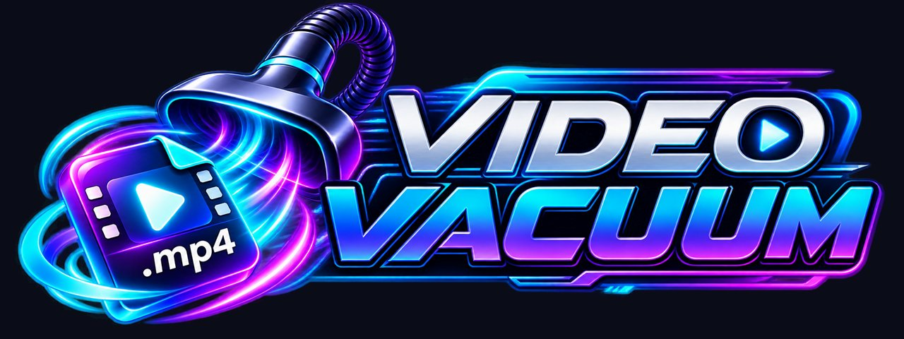
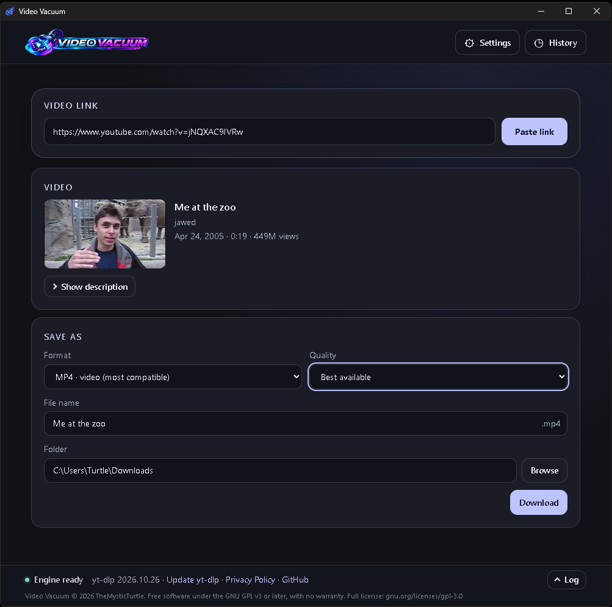
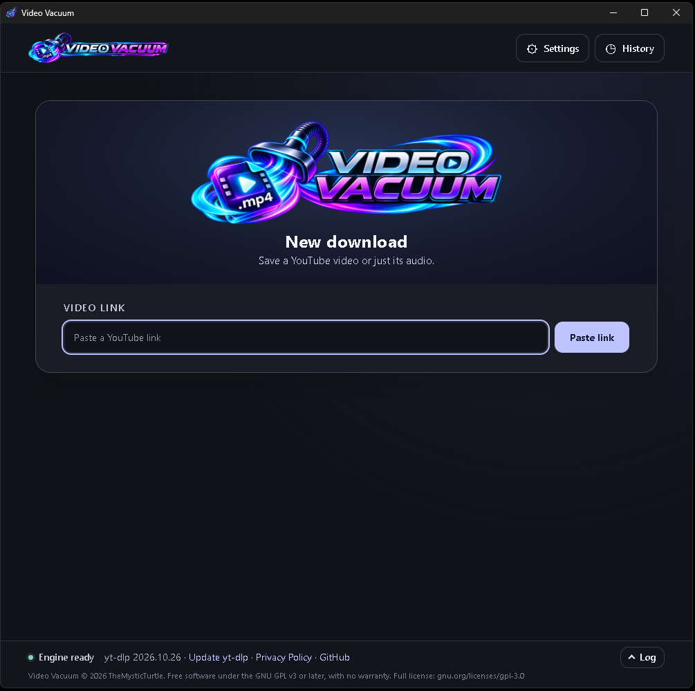
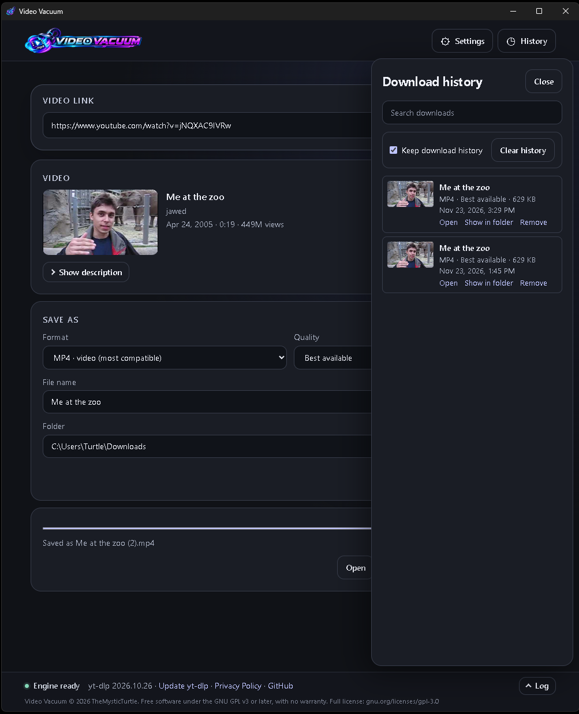
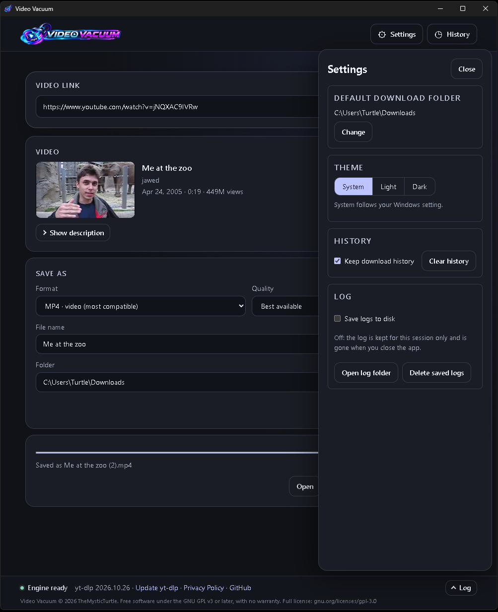
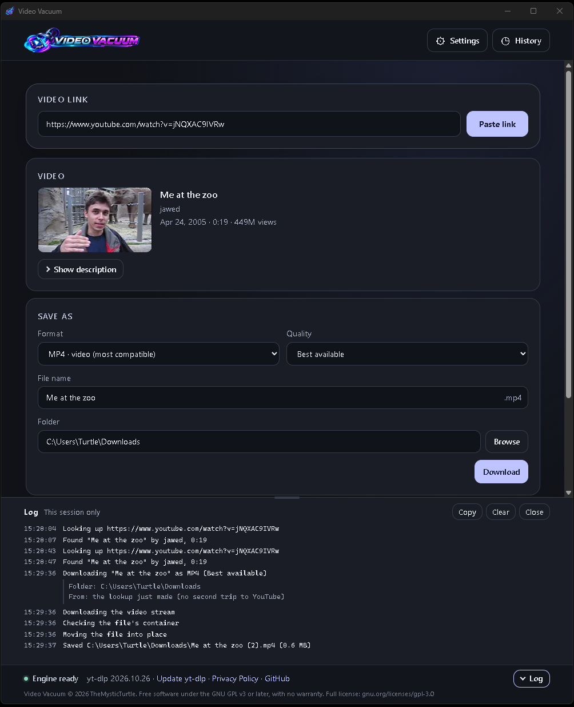

<h1 align="center"></h1>

A small Windows app for saving YouTube videos. Paste a link, pick a format,
quality, name and folder, click **Download**.

It runs on your computer using [yt-dlp](https://github.com/yt-dlp/yt-dlp).
Nothing is uploaded anywhere.

<p align="center"></p>

## Install

**Requires Windows 10 or 11** (64-bit). Windows 7 and 8.1 aren't supported:
the window's browser engine (Microsoft WebView2), current Rust programs, and
the tools it uses all need Windows 10 or newer.

1. Download `Video.Vacuum_<version>_x64-setup.exe` (for example
   `Video.Vacuum_2.0.0_x64-setup.exe`) from the
   [Releases](https://github.com/TheMysticTurtle/video-vacuum/releases) page and run it.
   - It installs just for you (no admin prompt) and adds Video Vacuum to the Start Menu.
   - The installer isn't code-signed yet, so Windows may show "Windows protected
     your PC". Click **More info → Run anyway**.
2. Open **Video Vacuum**. The first time, if the free tools it needs are missing
   (yt-dlp, ffmpeg, deno), click **Install missing tools**. A winget window opens;
   answer its questions there.

## Use it

### 1. Paste a link

Paste a YouTube link (or click **Paste link**). Messy links are fine: tracking
bits like `?si=` and `&t=` are trimmed, and Shorts, `youtu.be` and mobile links work.

<p align="center"></p>

### 2. Check the video and pick how to save it

You'll see the thumbnail, title, creator, upload date, length and views.
**Show description** opens the description. Click the title or creator to open
them on YouTube.

Pick a **Format**, **Quality**, **File name** and **Folder**, then **Download**.
You can cancel at any time; nothing half-finished is left behind.

### 3. History

**History** (top right) lists everything you've downloaded, with a search box.
- **Keep download history** turns recording on or off.
- **Clear history** empties the list (it asks first).
- **Remove** takes one entry off.
- Files you've moved or deleted are greyed out; click one to see where it used to be.
- Removing or clearing history never deletes your downloaded files.

<p align="center"></p>

### 4. Settings

**Settings** (next to History) has:
- your default download folder
- the **Theme**: System, Light or Dark (System follows Windows)
- the same history controls
- **Save logs to disk**

<p align="center"></p>

### 5. The Log

Click **Log** in the bar at the bottom to watch what the app is doing, step by
step. When something goes wrong, yt-dlp's own words appear under the error.
- You can keep using the app while it's open.
- Drag its top edge to resize it.
- **Copy** puts the whole log on the clipboard, for a bug report.
- The log is kept for the session only, unless you turn on
  **Settings → Save logs to disk** (kept 30 days).

<p align="center"></p>

### Formats

| Format | What you get |
|---|---|
| **MP4** | Most compatible: H.264 video + AAC audio up to 1080p (above 1080p YouTube only offers VP9/AV1) |
| **WebM** | VP9/AV1 video + Opus audio |
| **MKV** | The very best streams YouTube offers, kept exactly as-is |
| **M4A** | Audio only, exactly as YouTube sends it |
| **MP3** | Audio only, converted to MP3 at the bitrate you pick (128-320 kbps; 192 recommended) |

Nothing is re-encoded except MP3: YouTube sends video and audio separately,
and ffmpeg just packs them into one file. YouTube has no MP3, so that one is
converted, which loses a little quality. YouTube's audio is only about
110-160 kbps to begin with; at 192 kbps the MP3 sounds like the original for
most listeners, and 320 kbps adds extra margin at about two-thirds more file
size. Pick M4A for the original.

**If downloads start failing,** YouTube probably changed something. Click
**Update yt-dlp** in the bar at the bottom of the window, and check the **Log**
for what yt-dlp said.

## Build it yourself

You need Node.js, Rust (MSVC toolchain) and the WebView2 runtime (built into Windows 10/11).

```sh
npm install
npm run tauri dev     # run in development
npm run tauri build   # make the installer in src-tauri/target/release/bundle/nsis/
```

See `docs/TECH_REFERENCE.md` for the details. Releases are built, tested and
published by the **Release** GitHub Actions workflow, which is started by hand. The original browser-based
version is kept at the git tag `v1.0.0-local-web`.

## Privacy

Video Vacuum collects nothing: no analytics, no tracking, no accounts, no
server of its own. It only talks to YouTube (through yt-dlp) when you look up
or download a video, and keeps your history on your own computer. Details,
including how to delete that history: [PRIVACY.md](PRIVACY.md).

## Use it responsibly

Only download videos you have the right to save: your own uploads, openly
licensed videos, or content whose owner allows it. Follow YouTube's Terms of
Service and your local copyright law. This project isn't affiliated with
YouTube or Google.

## License

Copyright (C) 2026 TheMysticTurtle

Video Vacuum is free software: you can redistribute it and/or modify it under
the terms of the GNU General Public License as published by the Free Software
Foundation, either version 3 of the License, or (at your option) any later
version. It comes with no warranty. See [LICENSE](LICENSE) for the full text.

Versions up to `v1.0.0-local-web` were released under the MIT License.

The tools Video Vacuum runs (yt-dlp, FFmpeg, Deno) are separate programs with
their own licenses. Video Vacuum doesn't include them.
